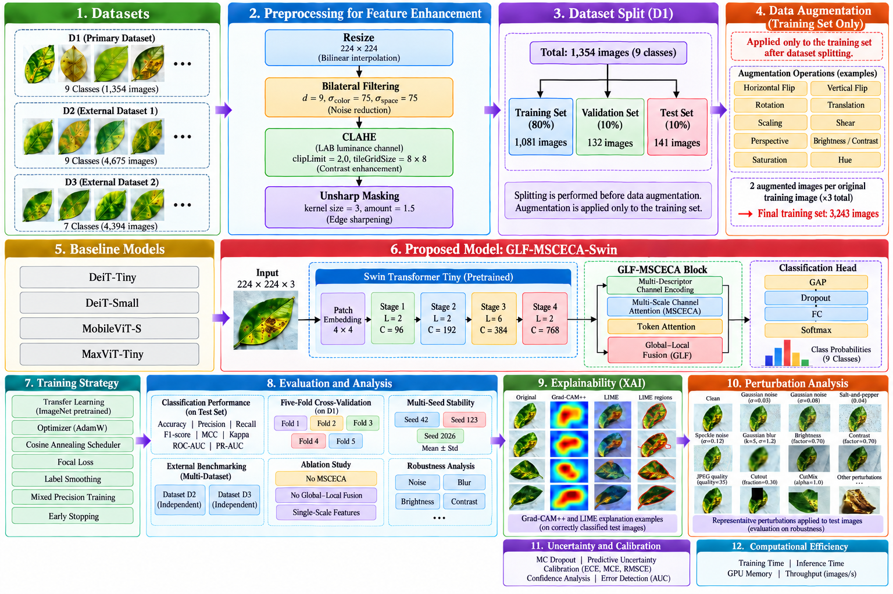
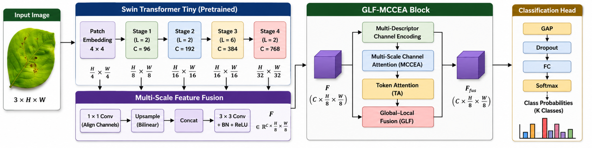
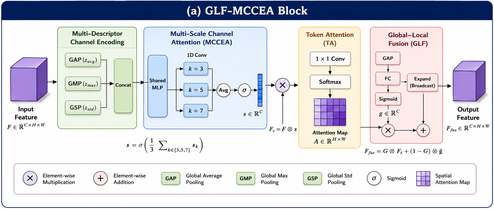
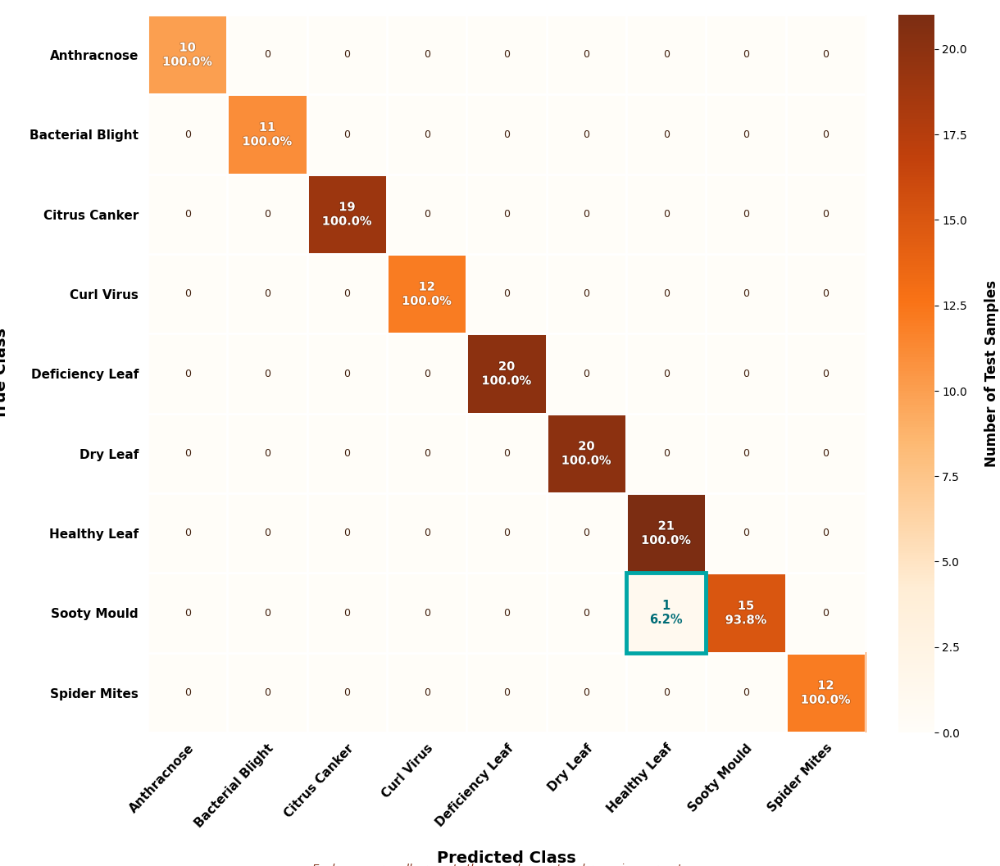
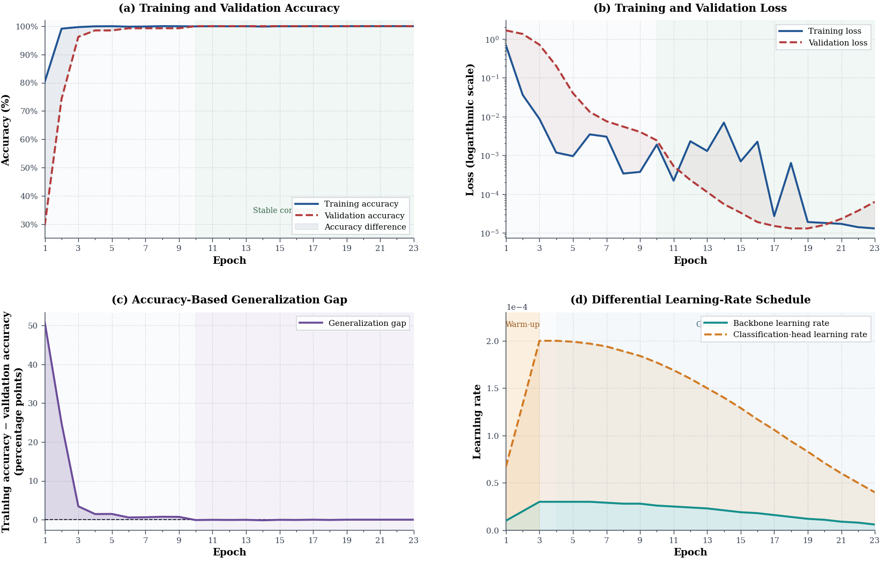
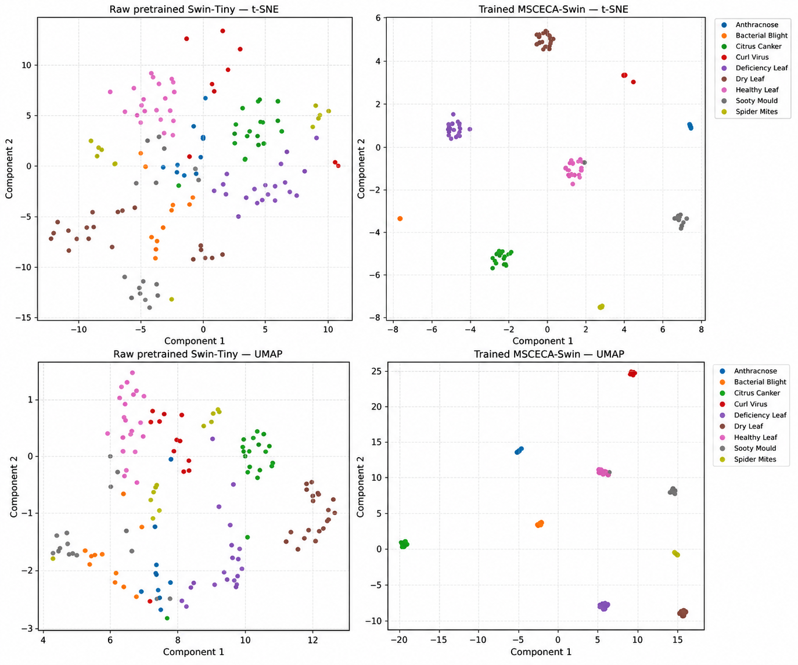
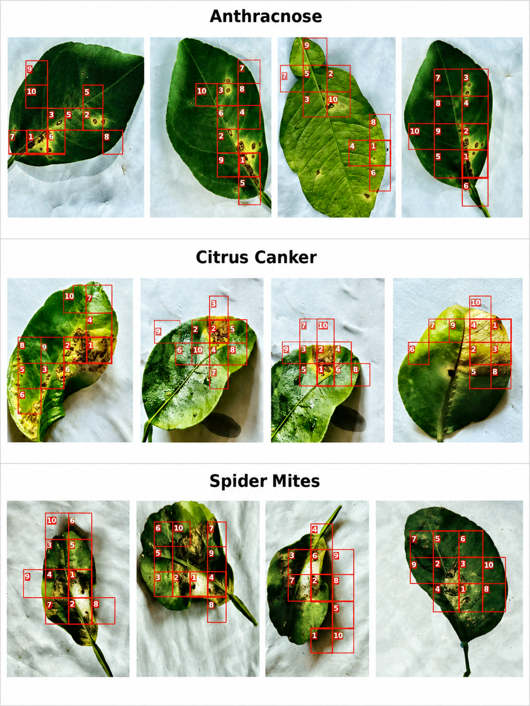
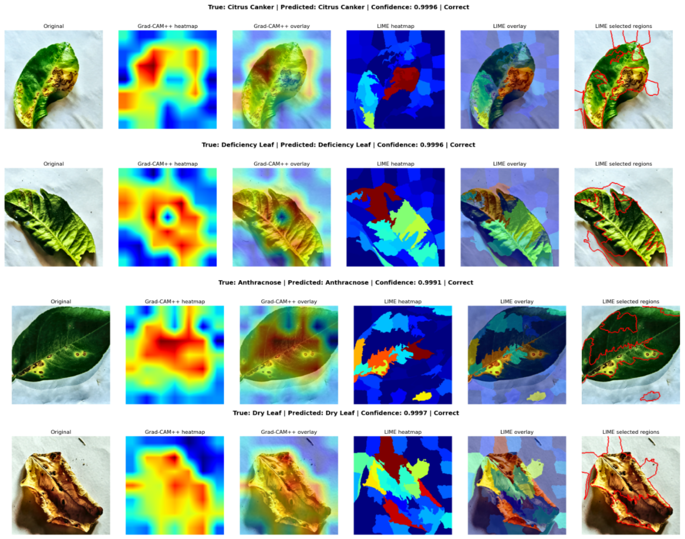
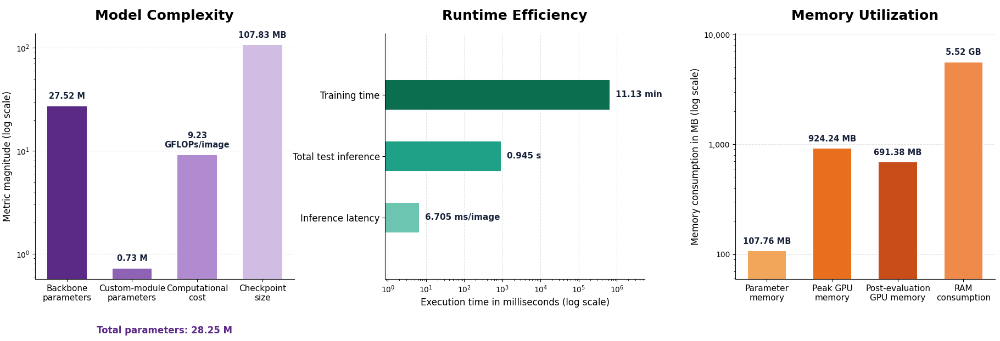

# Precision Agriculture-Oriented Lemon Leaf Disease Classification Using Global–Local Interaction Learning and Multi-Scale Channel Attention

<p align="center">
  
</p>

**Model:** GLF-MSCECA-Swin — Global–Local Fusion Multi-Scale Efficient Channel Attention-enhanced Swin-Tiny Transformer  
**Task:** Multiclass lemon (*Citrus*) leaf disease classification  
**Framework:** PyTorch · Swin-Tiny · Explainable AI

## Authors

- **Md. Ehsanul Haque**¹
- **Md. Saymon Hosen Polash**¹
- **Sumaiya Tabassum**²
- **Pintu Chandra Shill**¹* (Corresponding author)
- **M. Ruhul Amin**¹
- **Sohel Rana**¹
- **Afsana Al Sharmin**¹

¹ Department of Mathematics and Data Science, East West University, Dhaka 1212, Bangladesh  
² Department of Computer Science and Engineering, East West University, Dhaka 1212, Bangladesh  
*Correspondence:* [pintu.shill@ewubd.edu](mailto:pintu.shill@ewubd.edu)

## Abstract

Lemon (*Citrus*) leaf diseases significantly affect fruit quality and agricultural productivity. Automated disease classification remains challenging because different diseases often exhibit similar visual symptoms, while field images are subject to variations in illumination, background, leaf orientation, and image quality. To overcome these issues, this paper puts forward a framework, GLF-MSCECA-Swin, which is based on the Swin-Tiny network. The proposed framework integrates hierarchical multi-scale feature aggregation, multi-statistic efficient channel attention, token-level attention, and learnable global–local feature interaction to capture complementary lesion details and contextual information. These mechanisms enable adaptive feature refinement and fusion across multiple representation levels, improving discrimination among visually similar lemon leaf disease classes. The proposed framework was extensively tested on several public Lemon (*Citrus*) leaf disease datasets through classification, cross-validation, robustness, uncertainty, calibration, interpretability, and computational-efficiency analyses. The proposed model achieved an accuracy of **99.29%**, Macro Precision of **99.49%**, Macro Recall of **99.31%**, Macro F1-score of **99.38%**, and a Matthews Correlation Coefficient of **0.9920** on the primary dataset. The mean accuracy obtained using five-fold cross-validation was **99.81% ± 0.41%**, indicating the model's robustness with respect to variations in data splits. The accuracy and Macro F1-score remained above **95.74%** and **94.65%**, respectively, under eleven image-corruption conditions. MC Dropout improved the Macro PR-AUC from **0.9864 to 0.9934** and reduced the Expected Calibration Error from **0.00635 to 0.00548**. The model further achieved **98.32%** accuracy on D2 and **94.58%** on D3. These results demonstrate that GLF-MSCECA-Swin can accurately, robustly, interpretably, and efficiently recognize Lemon (*Citrus*) leaf diseases.

## Highlights

- **Hierarchical multi-scale learning:** combines features from the final three Swin-Tiny stages.
- **MSCECA:** uses average, maximum, and standard-deviation descriptors with 1D convolution kernels of sizes 3, 5, and 7.
- **Token attention:** emphasizes informative spatial regions.
- **Learnable global–local fusion:** integrates whole-leaf context and fine lesion details.
- **Comprehensive evaluation:** cross-validation, ablations, multiple random seeds, image corruptions, uncertainty/calibration, Grad-CAM++, LIME, and computational efficiency.

## Key Results

| Evaluation | Result |
|---|---:|
| D1 test accuracy | **99.29%** (140/141 correct) |
| D1 macro precision | **99.49%** |
| D1 macro recall | **99.31%** |
| D1 macro F1-score | **99.38%** |
| D1 Matthews correlation coefficient | **0.9920** |
| 5-fold cross-validation accuracy | **99.81% ± 0.41%** |
| D2 test accuracy | **98.32%** |
| D3 test accuracy | **94.58%** |
| Total model parameters | **28.25 M** |
| Computational cost | **9.23 GFLOPs/image** |
| Reported inference latency | **6.705 ms/image** |

> **Evaluation note:** D2 and D3 were **trained and tested separately using the same model architecture**. Their scores demonstrate multi-dataset benchmarking, **not** zero-shot transfer of a model trained only on D1.

## Datasets

| Dataset | Classes | Images | Usage | Source |
|---|---:|---:|---|---|
| D1 — Comprehensive Lemon Leaf Disease Dataset | 9 | 1,354 | Primary model development and evaluation | [Mendeley Data](https://doi.org/10.17632/44nrn4593f.1) |
| D2 — Lemon Leaf Disease Image Dataset | 9 | 4,675 | Separate benchmarking | [Mendeley Data](https://doi.org/10.17632/9ywvpv3xtg.1) |
| D3 — Citrus Diseases and Healthy Leaves from Bangladesh | 7 | 4,394 | Separate benchmarking | [Mendeley Data](https://doi.org/10.17632/smz8ffbthy.3) |

**D1 categories:** Anthracnose, Bacterial Blight, Citrus Canker, Curl Virus, Deficiency Leaf, Dry Leaf, Healthy Leaf, Sooty Mould, and Spider Mites.

**D1 split:** 1,081 training / 132 validation / 141 test images. Two augmented images were produced for each training image, yielding **3,243 training samples** total; validation and test images were not augmented.

## Proposed Method

### Full workflow


1. **Preprocess images:** resize to 224 × 224; apply bilateral filtering, CLAHE, and mild unsharp masking.
2. **Create the data split and augment training samples only.**
3. **Extract multi-level features** using an ImageNet-pretrained Swin-Tiny backbone.
4. **Align and adaptively aggregate features** from multiple stages.
5. **Apply MSCECA** to prioritize useful channels and refine local lesion features.
6. **Use token attention** to build a global representation and **learnable global–local fusion** to combine representations.
7. **Predict one of nine D1 classes** using a classification head and softmax.
8. **Evaluate** performance, stability, robustness, interpretability, uncertainty, and resource requirements.

### Architecture



### Multi-scale channel attention and global–local fusion



*Figure-label note: some supplied artwork uses “MCCEA”; the manuscript names the proposed module “MSCECA.”*

## Training Configuration

| Setting | Value |
|---|---|
| Framework | PyTorch |
| Input size | 224 × 224 |
| Backbone initialization | ImageNet pretrained |
| Optimizer | AdamW |
| Maximum epochs | 30 |
| Batch size | 16 |
| Backbone learning rate | 3 × 10⁻⁵ |
| Classification-head learning rate | 2 × 10⁻⁴ |
| Learning-rate schedule | Cosine annealing, 3 warm-up epochs |
| Loss | Weighted multiclass focal loss (γ = 1.5) |
| Early stopping | Patience 5 |
| Checkpoint selection | Best validation macro F1 |
| Hardware | NVIDIA Tesla T4 (Kaggle Notebook) |

## Results and Visualizations

### Confusion matrix

The primary D1 test set contained **one error**: a Sooty Mould image was predicted as Healthy Leaf.



### Training and validation dynamics



### Learned features: t-SNE and UMAP

The trained model shows more compact class groupings in these two-dimensional visualizations than the unadapted pretrained backbone.



### Token-level attention

Red numbered rectangles show highly attended token regions for example disease images.



### Explainable AI: Grad-CAM++ and LIME

These visualizations highlight image regions influential to example predictions; they do not by themselves prove causal reasoning.



### Computational efficiency



## Additional Analyses Reported in the Paper

- **Cross-validation:** stratified five-fold evaluation on non-augmented development data.
- **Multi-seed stability:** multiple independently trained runs to assess sensitivity to randomness.
- **Ablation:** removal of MSCECA, token attention, fusion gate, and global–local interaction to evaluate individual contributions.
- **Image-corruption tests:** different noise, blur, low illumination/contrast, JPEG compression, Cutout, and CutMix conditions.
- **Calibration and uncertainty:** deterministic predictions versus 20 stochastic MC Dropout passes.
- **Explanations:** Grad-CAM++ and LIME, including qualitative comparisons.

## Code and Reproducibility

This repository currently packages **paper information and figures**. **Training and inference source code, model weights, dependencies, and reproducibility commands have not yet been included.** Add verified implementation files and execution instructions when they are ready; do not treat the figures as executable code.

Suggested layout for a future full release:

```text
GLF-MSCECA-Swin/
├── README.md
├── assets/
├── src/                  # add actual implementation when available
├── requirements.txt      # add verified dependencies
├── train.py              # add actual training entry point
├── evaluate.py           # add actual evaluation entry point
└── LICENSE               # add only after choosing a license
```

## Citation

If you use or reference this research, please cite the paper once publication metadata is available:

> Md. Ehsanul Haque, Md. Saymon Hosen Polash, Sumaiya Tabassum, Pintu Chandra Shill, M. Ruhul Amin, Sohel Rana, and Afsana Al Sharmin. **“Precision Agriculture-Oriented Lemon Leaf Disease Classification Using Global–Local Interaction Learning and Multi-Scale Channel Attention.”** Manuscript. Publication venue and DOI to be added upon publication.

## Contact

**Corresponding author:** [Pintu Chandra Shill](mailto:pintu.shill@ewubd.edu)  
**GitHub:** [@polash102](https://github.com/polash102)

---

*The experimental values and manuscript details above are transcribed from the provided paper draft; they have not been independently reproduced.*
